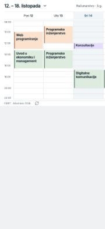
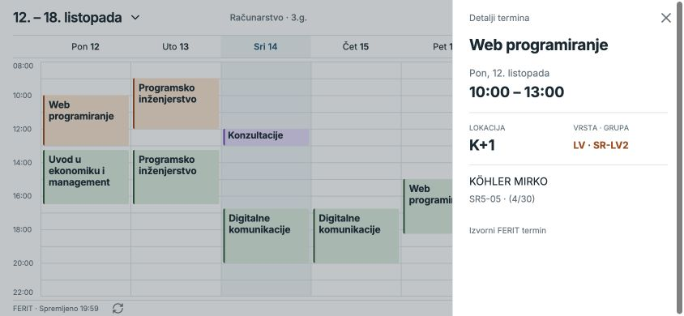
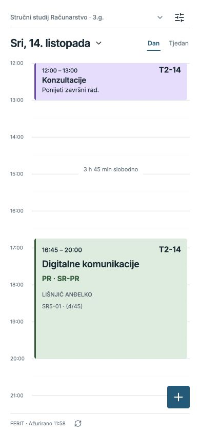
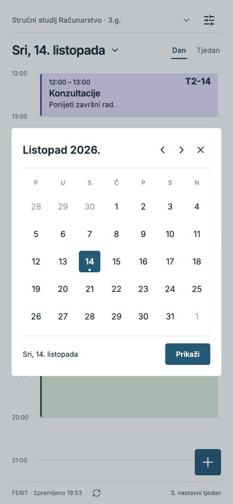
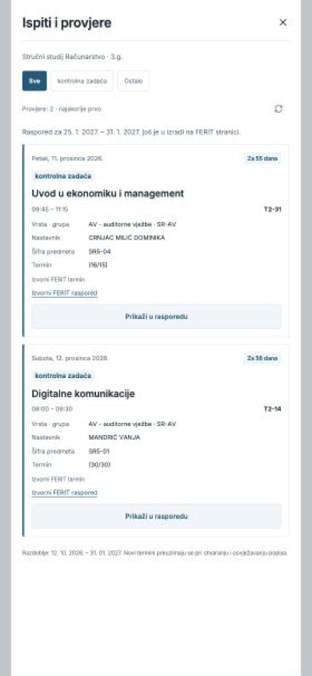
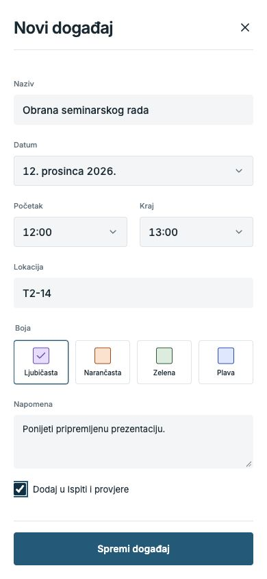
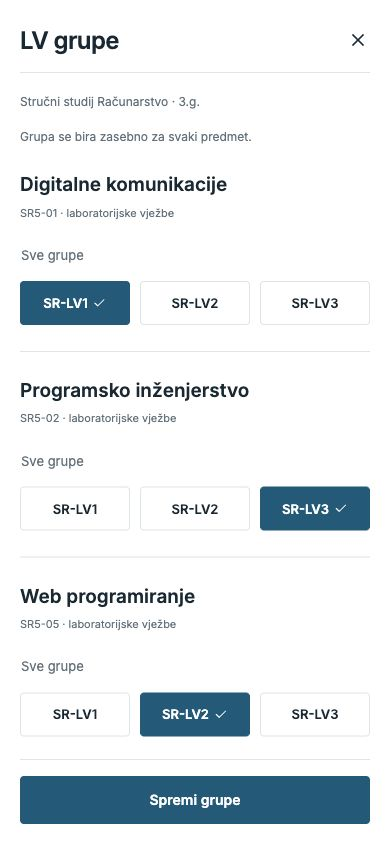
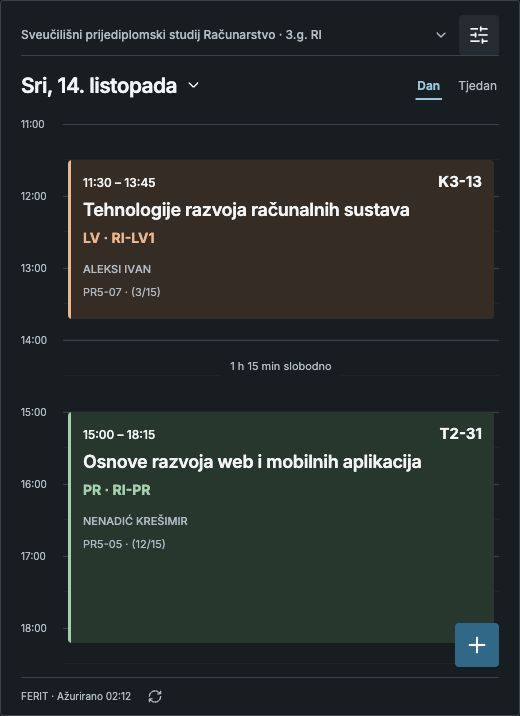

# FERIT raspored

Tvoj FERIT raspored na mobitelu — nastava, ispiti i osobni događaji u jednom kalendaru. Aplikacija je na hrvatskom jeziku.

## Instalacija na Android

[Preuzmi APK — verzija 1.0.14](https://github.com/KTihana/FERIT-raspored/releases/download/v1.0.14-android-test/FERIT-raspored.apk) · Android 7.0 ili noviji

Preuzmi APK, otvori ga i instaliraj aplikaciju. Ako je već imaš, instaliraj novu verziju preko postojeće da ti ostanu spremljeni odabiri. Aplikacija radi na mobitelu, a internet treba za preuzimanje FERIT rasporeda i provjeru ažuriranja.

## Cijeli tjedan na jednom mjestu

Cijeli tjedan vidiš odjednom: kad imaš nastavu, gdje su pauze i koliko ti ostaje slobodnog vremena. Samo okreni mobitel ili odaberi **Tjedan**.

**Dodirni termin za detalje.** Sa strane se otvara panel sa svim podacima: predmet, datum, vrijeme, lokacija, vrsta nastave, grupa i nastavnik. Želiš nešto promijeniti? Zadrži prst na terminu.

## Dnevni raspored i kalendar

Povuci prst lijevo ili desno za drugi dan. Za neki drugi datum dodirni datum na vrhu i odaberi dan u kalendaru. U dnevnom rasporedu odmah vidiš vrijeme, lokaciju i svoje napomene.

 

## Ispiti i osobni događaji

U **Ispiti i provjere** vidiš što te uskoro čeka — najbliži termin je prvi, a vrijeme i lokacija odmah su tu. Gumb **Prikaži u rasporedu** vodi te ravno na taj termin.

Možeš dodati i svoje događaje, odabrati boju, zapisati napomenu i uključiti ih u popis provjera. Ako se promijeni vrijeme ili lokacija nastave, zadrži prst na terminu i prilagodi ga u svom rasporedu.

 

## Prilagodi raspored sebi

Za svaki predmet odaberi svoju LV grupu, a za izgled aplikacije svijetlu ili tamnu temu. Kad jednom preuzmeš raspored za neki tjedan, možeš ga gledati i bez interneta. Tvoji događaji i izmjene ostaju spremljeni.

 

Osobni događaji i izmjene na slikama služe kao primjer. Tvoje se promjene spremaju samo na tvom mobitelu i ne mijenjaju službeni FERIT raspored.

[Vodič za korištenje](docs/guide.md)

## Ažuriranja

Kad se pojavi **Dostupno ažuriranje**, dodirni **Preuzmi** i potvrdi instalaciju na Androidu. Ažuriranje možeš provjeriti i samostalno: **Postavke → Ažuriranja aplikacije → Provjeri ažuriranja**.

Za povratak na izvorni raspored idi na **Postavke → Vrati izvorni raspored**.

[Izvorni projekt](https://github.com/KTihana/FERIT-raspored/releases/download/v1.0.14-android-test/FERIT-raspored-source.zip) · Za instalaciju na iPhone trebaju Xcode i potpisivanje aplikacije putem Applea.
