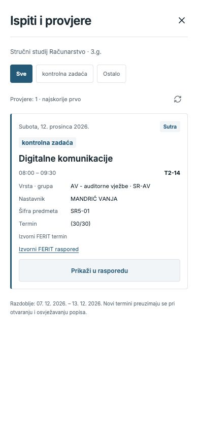
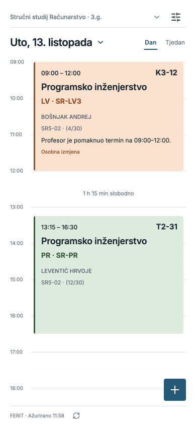
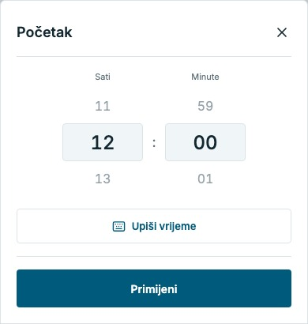
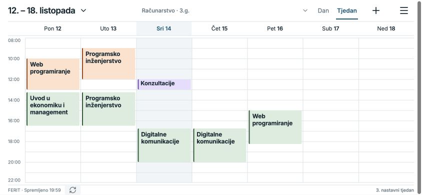
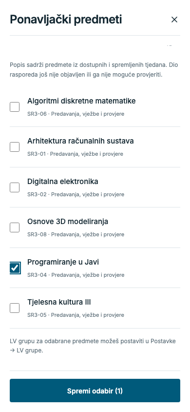
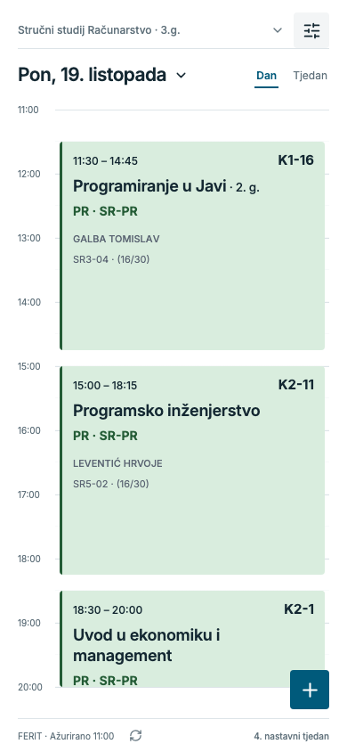

  

<h1 align="center">FERIT raspored</h1>

Nastava, ispiti i tvoji događaji u jednom kalendaru.

  

Android 7.0+ · Otvori APK i instaliraj preko postojeće aplikacije da zadržiš svoje odabire.

## Pogled u aplikaciju

**Cijeli tjedan** — nastava, pauze i tvoji događaji na jednom mjestu.

**Detalji termina** — dodirni termin za predmet, vrijeme, lokaciju i nastavnika.

<table>
  <tr><th>Dnevni raspored</th><th>Kalendar</th></tr>
  <tr>
    <td></td>
    <td></td>
  </tr>
  <tr><th>Ispiti i provjere</th><th>Tvoji događaji i napomene</th></tr>
  <tr>
    <td></td>
    <td></td>
  </tr>
  <tr><th>LV grupa za svaki predmet</th><th>Tamna tema</th></tr>
  <tr>
    <td></td>
    <td></td>
  </tr>
  <tr><th>Osobne izmjene termina</th><th>Odabir vremena</th></tr>
  <tr>
    <td></td>
    <td></td>
  </tr>
</table>

**Raspored bez interneta** — preuzeti tjedni ostaju na mobitelu.

**Ponavljački predmeti** — označi predmet s godine neposredno ispod tvoje i odaberi njegove objavljene vrste nastave: samo predavanja, samo vježbe ili željenu kombinaciju.

 

[Vodič za korištenje](docs/guide.md)
