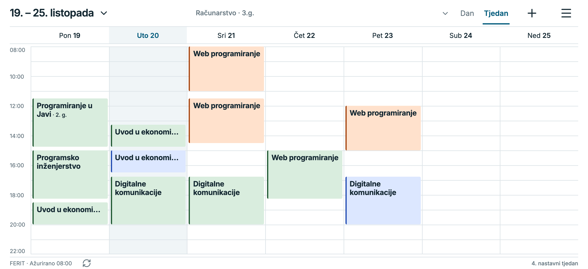
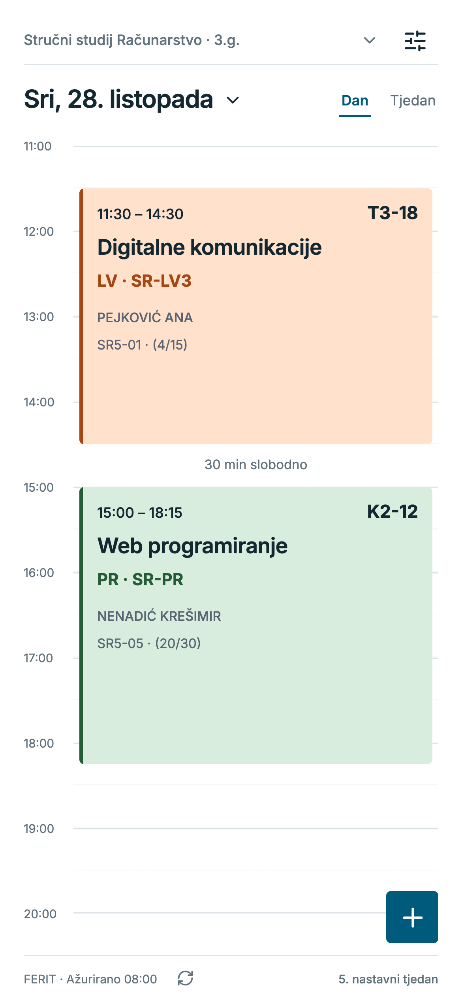
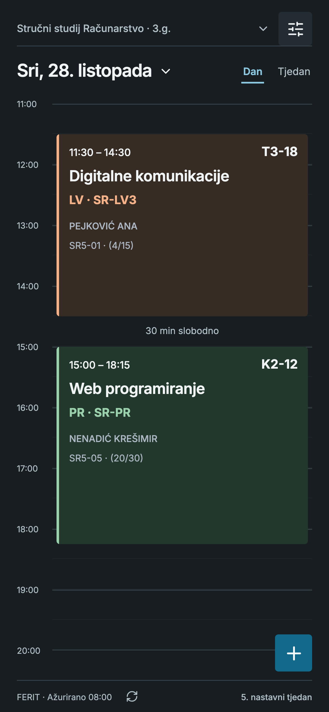
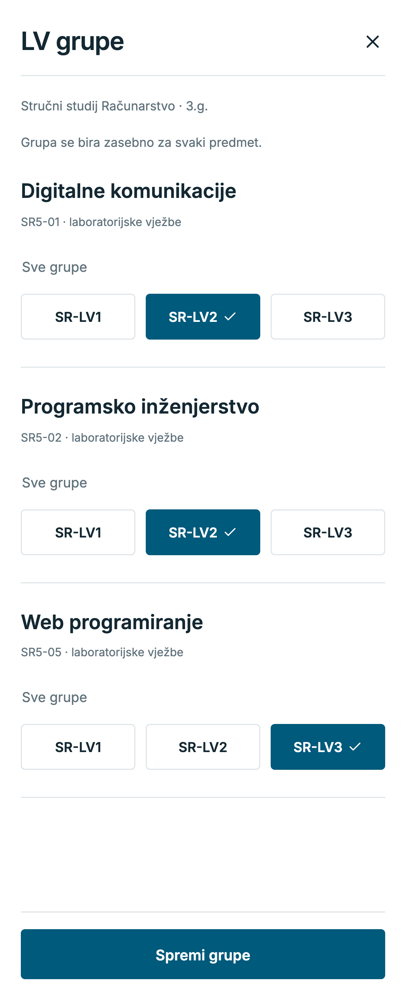
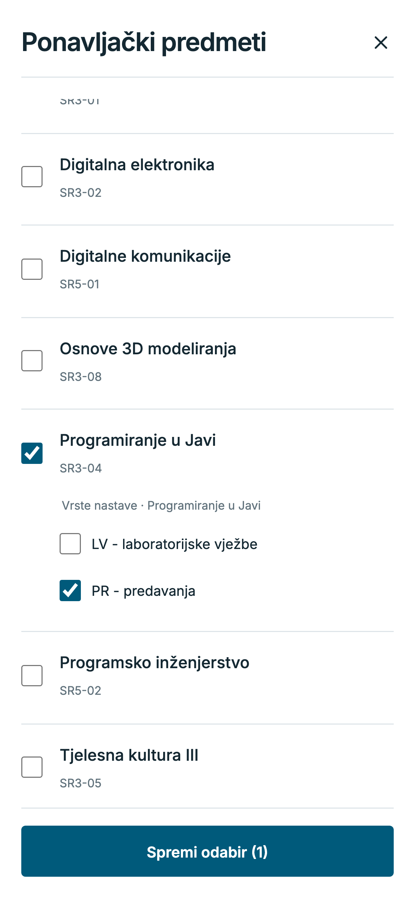
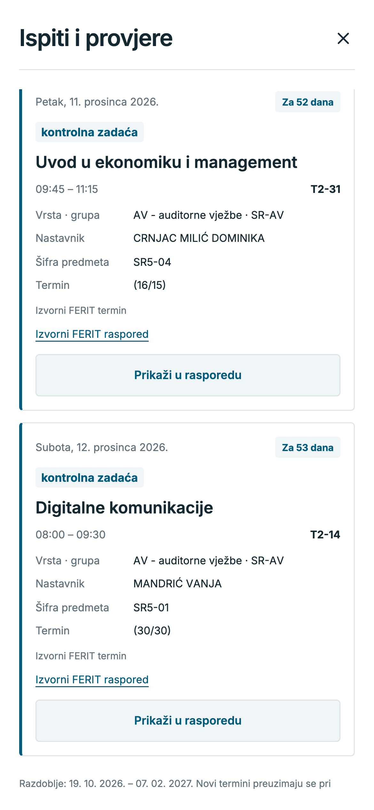
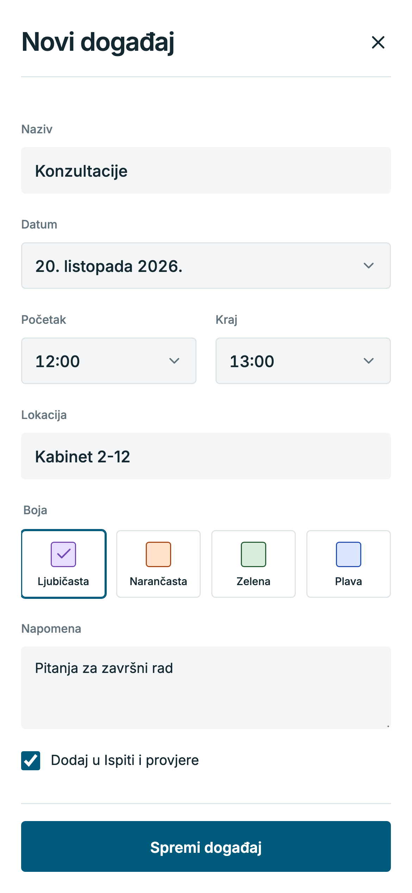
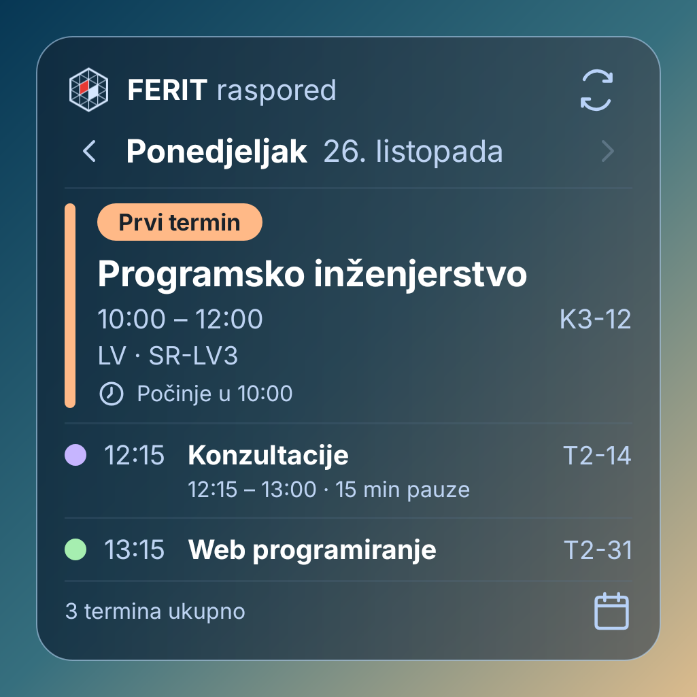

<h1 align="center">FERIT raspored</h1>

Nastava, ispiti i tvoji događaji na jednom mjestu.

Android 7.0+ · Instaliraj preko postojeće aplikacije da zadržiš svoje odabire.

## Sve što trebaš za svoj raspored

- **Tvoj raspored** — Odaberi studij i godinu, pregledaj dan ili cijeli tjedan te brzo pronađi datum u kalendaru.
- **LV grupe i ponavljački predmeti** — Postavi LV grupu za svaki predmet i dodaj predmete s prethodne godine uz odabir vrsta nastave.
- **Ispiti i provjere** — Nadolazeći termini, najskoriji prvi, s filtrima i prečacem do rasporeda.
- **Osobni događaji** — Dodaj događaj, boju, lokaciju i napomenu; po želji ga uključi i u provjere.
- **Osobne izmjene** — Pomakni ili ukloni termin samo u svojem rasporedu i po potrebi vrati izvorni.
- **Bez interneta** — Preuzeti tjedni, tvoji događaji i odabiri dostupni su i izvan mreže.
- **Izgled i pregled** — Svijetla i tamna tema, vodoravni tjedni prikaz, pauze, nastavni tjedan i detalji termina.
- **Android widget** — Danas i sljedećih šest dana, tijek nastave, preostalo vrijeme i sljedeći termini.
- **Ažuriranja** — Provjeri i preuzmi novu verziju iz aplikacije te otvori izvorni FERIT raspored.

## Cijeli tjedan na jednom zaslonu

## Pogled u aplikaciju

<table>
<tr><th>Dnevni raspored</th><th>Tamna tema</th></tr>
<tr><td></td><td></td></tr>
<tr><th>LV grupe po predmetu</th><th>Ponavljački predmeti i vrste nastave</th></tr>
<tr><td></td><td></td></tr>
<tr><th>Ispiti i provjere</th><th>Događaji, boje i napomene</th></tr>
<tr><td></td><td></td></tr>
</table>

## Raspored na početnom zaslonu

Pregledaj sedam dana i otvori odabrani datum u aplikaciji. Widget dodaj kroz **Postavke → Widget na početnom zaslonu**.

[Vodič za korištenje](docs/guide.md) · [Najnovije izdanje](https://github.com/KTihana/FERIT-raspored/releases/latest) · [Izvorni projekt](phone-app/README.md)
