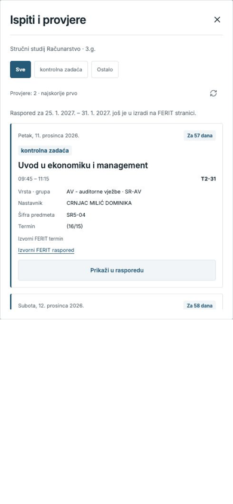

# FERIT raspored

Tvoj FERIT raspored na telefonu — nastava, ispiti i osobni događaji u jednom kalendaru. Aplikacija je na hrvatskom jeziku.

## Cijeli tjedan na jednom mjestu

Pregledaj svih sedam dana na zajedničkoj vremenskoj osi, uz obojene termine i jasno vidljivo slobodno vrijeme. Okreni telefon ili odaberi **Tjedan** za tjedni prikaz.

**Dodirni termin za detalje.** Otvara se bočni panel s punim nazivom predmeta, datumom, vremenom, lokacijom, vrstom nastave, grupom i nastavnikom. Dugim pritiskom otvaraš uređivanje.

## Dnevni raspored i kalendar

Povuci prst za prelazak na prethodni ili sljedeći dan, ili dodirni datum i odaberi dan u mjesečnom kalendaru. Vrijeme nastave, lokacije i osobne napomene vidljivi su u dnevnom prikazu.

 

## Ispiti i osobni događaji

U **Ispiti i provjere** pregledaj nadolazeće ispite i provjere, poredane od najskorijeg termina, s vremenom, lokacijom i gumbom **Prikaži u rasporedu**. Dodaj osobni događaj, odaberi boju, zapiši napomenu i po želji ga uključi u popis provjera. Dugim pritiskom na termin spremi osobnu izmjenu datuma, vremena ili lokacije.

 

## Prilagodi raspored sebi

Odaberi svoju LV grupu zasebno za svaki predmet i biraj između svijetle i tamne teme. Uspješno preuzeti tjedni ostaju dostupni bez interneta, zajedno s osobnim događajima i izmjenama.

 

Osobni događaji i izmjene na snimkama primjeri su korištenja. Spremaju se na uređaju i ne mijenjaju službeni FERIT raspored.

[Vodič za korištenje](docs/guide.md)

## Instalacija na Android

[Preuzmi APK — verzija 1.0.14](https://github.com/KTihana/FERIT-raspored/releases/download/v1.0.14-android-test/FERIT-raspored.apk) · Android 7.0 ili noviji

Otvori preuzetu datoteku i instaliraj aplikaciju. Instalacijom preko postojeće verzije zadržavaš spremljene odabire. Aplikacija radi lokalno; internet je potreban za preuzimanje FERIT rasporeda i provjeru ažuriranja.

## Ažuriranja

Kad se pojavi **Dostupno ažuriranje**, dodirni **Preuzmi** i potvrdi instalaciju na Androidu. Ručna provjera: **Postavke → Ažuriranja aplikacije → Provjeri ažuriranja**.

Za povratak na izvorni raspored odaberi **Postavke → Vrati izvorni raspored**.

[Izvorni projekt](https://github.com/KTihana/FERIT-raspored/releases/download/v1.0.14-android-test/FERIT-raspored-source.zip) · Instalacija na iPhone zahtijeva Xcode i Appleovo potpisivanje aplikacije.
