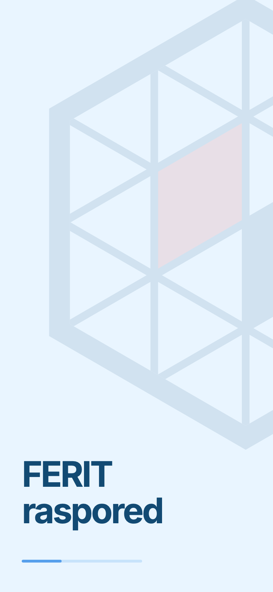
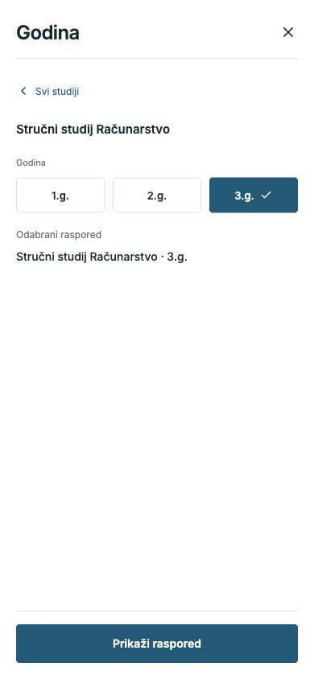
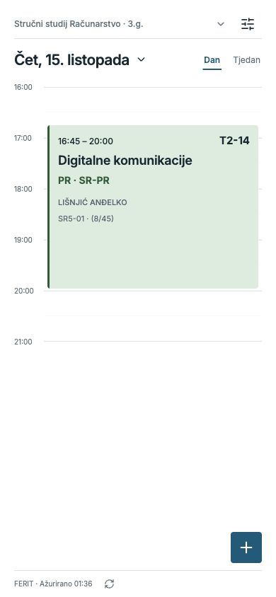
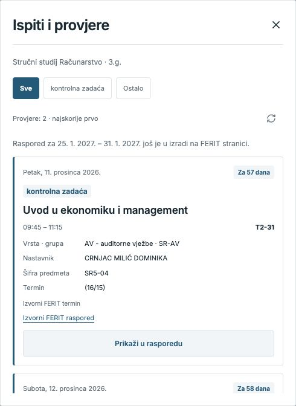
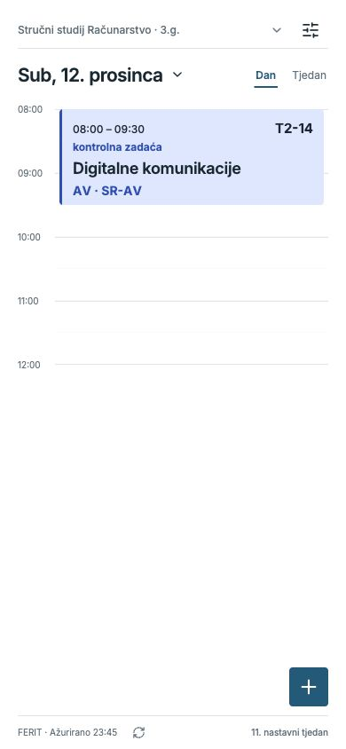
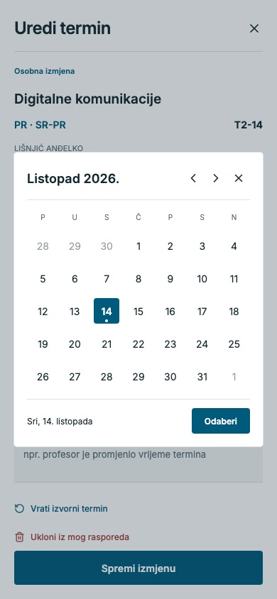
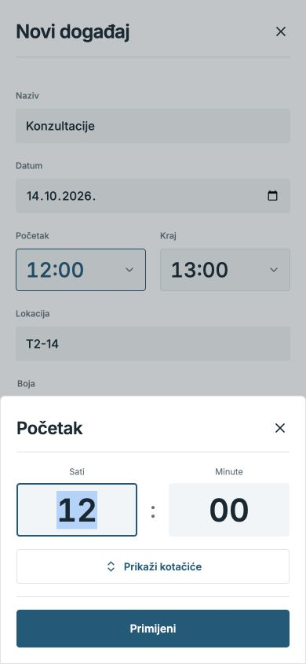
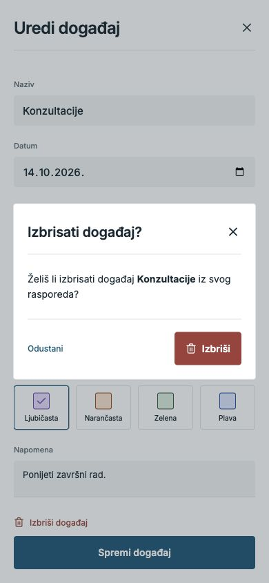

# FERIT raspored — vodič sa slikama

[Preuzmi Android aplikaciju](https://github.com/KTihana/FERIT-raspored/releases/download/v1.0.14-android-test/FERIT-raspored.apk)

Snimke prikazuju izgled aplikacije. Trenutačna verzija: **1.0.14**. Dodane konzultacije i pomaknuti termin primjeri su korištenja aplikacije, a ne obavijesti fakulteta.

## Otvaranje aplikacije

Početni zaslon s vektorskim logotipom i nazivom **FERIT raspored** automatski prelazi na tvoj današnji raspored, ili na odabir rasporeda pri prvom otvaranju.

## Odaberi svoj raspored

Odaberi studij i godinu. Aplikacija pamti odabir i pri sljedećem otvaranju prikazuje raspored za današnji datum.

## Jučer i sutra jednim potezom

Povuci prst **ulijevo za sljedeći dan**, a **udesno za prethodni**. Možeš i **dodirnuti desni rub za sljedeći dan ili lijevi rub za prethodni**, čak i preko obojenog termina. Dugim pritiskom i dalje otvaraš uređivanje. Za određeni datum dodirni datum na vrhu. Položaj i duljina obojenih termina pokazuju trajanje nastave i slobodno vrijeme između termina.

 

Dodirni datum za kalendar. Povuci **ulijevo za sljedeći mjesec** ili **udesno za prethodni**, odaberi datum pa dodirni **Prikaži**.

## Nastavni tjedan i spremljeni raspored

Oznaka **nastavnog tjedna** nalazi se desno u postojećem donjem retku, u dnevnom i vodoravnom prikazu. Preuzima se iz FERIT rasporeda za prikazani tjedan.

Svaki uspješno preuzet tjedan ostaje spremljen na telefonu. Ako FERIT nije dostupan ili nemaš internet, prikazuje se spremljeni raspored s oznakom **Spremljeno** i vremenom posljednjeg preuzimanja. Osobni događaji, izmjene i LV odabiri ostaju vidljivi. Pri otvaranju aplikacije, ako današnji tjedan nije spremljen, aplikacija otvara posljednji spremljeni tjedan za isti studij s njegovim stvarnim datumima. Za druge nepreuzete tjedne nudi povratak na spremljeni tjedan. Raspored za tjedan koji još nije preuzet treba internet.

## Svijetla i tamna tema

U **Postavke → Izgled** odaberi **Svijetla** ili **Tamna**. Aplikacija pamti odabranu temu.

## Prikaži svoju LV grupu

U **Postavke → LV grupe** odaberi svoju grupu zasebno za svaki predmet. Možeš biti, primjerice, **LV3 iz Programskog inženjerstva**, a **LV2 iz Web programiranja**. Raspored zatim prikazuje samo odabrane laboratorijske grupe za te predmete; zajednička predavanja ostaju vidljiva.

## Ispiti i provjere na jednom mjestu

Otvori **Postavke → Ispiti i provjere** za nadolazeće ispite i druge provjere iz svojeg odabranog rasporeda. **Najskoriji termin je prvi.** Svaka kartica odmah prikazuje sve dostupne podatke: dan i datum, za koliko je dana, vrijeme, lokaciju, nastavnika, vrstu i grupu, šifru predmeta, redni broj termina i napomenu. Gumb **Prikaži u rasporedu** nalazi se na dnu svake kartice i otvara isti termin u rasporedu.

Filtri koriste stvarne oznake iz FERIT rasporeda, primjerice **kontrolna zadaća**, **Kolokvij** ili **teorijski kolokvij**, kada su objavljene. Oznake su vidljive i na terminima u dnevnom i tjednom rasporedu, čak i kada je vrsta nastave AV, PR ili LV.

Popis pri otvaranju i osvježavanju provjerava trenutačni i sljedećih 15 tjedana. Ako FERIT još priprema raspored za neki tjedan, vidiš njegove datume i obavijest da je raspored još u izradi na FERIT stranici. Problemi s dohvatom imaju zasebno upozorenje da popis može biti nepotpun. Bez interneta mogu se prikazati prethodno spremljeni tjedni.

 

## Dodaj vlastiti događaj

Dodirni **+** i unesi naziv, datum, početak, kraj i lokaciju. Polje **Datum** otvara isti kalendar kao datum iznad rasporeda: odaberi dan pa dodirni **Odaberi**. Zatvaranje kalendara odbacuje nepotvrđen izbor. Za vrijeme dodirni **Početak** ili **Kraj**. U odabiru pomakni sate ili minute, ili dodirni **Upiši vrijeme** za brojčanu tipkovnicu. **Primijeni** potvrđuje vrijeme; zatvaranje odabira odbacuje promjenu. Odaberi boju i dodaj napomenu — primjerice, što trebaš ponijeti na konzultacije.

Ispod **Napomena** možeš uključiti **Dodaj u Ispiti i provjere**. Takav osobni događaj prikazuje se u filtrima **Sve** i **Ostalo**, a ostaje i u tvojem rasporedu. Isključi opciju pri uređivanju ako ga želiš ukloniti samo s popisa provjera.

Napomena se prikazuje ispod naslova u dnevnom rasporedu. Dodir u dnevnom prikazu ne otvara dodatni panel; za uređivanje zadrži prst na događaju.

 

## Prilagodi termin kad profesor promijeni vrijeme

**Zadrži prst na terminu** da otvoriš uređivanje. Možeš promijeniti datum, vrijeme ili lokaciju i zapisati napomenu. Na primjeru je termin pomaknut s **08:00–11:00 na 09:00–12:00**, uz prikaz izvornog FERIT termina.

Spremljeni termin dobiva oznaku **Osobna izmjena**. Izmjena se sprema na tvom uređaju; ne mijenja raspored na FERIT stranici.

## Cijeli tjedan u vodoravnom prikazu

Uz uključenu automatsku rotaciju, **okreni telefon** za pregled cijelog tjedna. Možeš odabrati i **Tjedan**. Svih sedam dana i vremenska os stanu u jedan pregled, a razmaci između termina ostaju vidljivi.

**Dodirni bilo koji termin u tjednom prikazu** za puni naziv, vrijeme, podebljanu lokaciju, LV grupu, nastavnika i ostale podatke. Detalji se otvaraju preko rasporeda. Dugim pritiskom i dalje otvaraš uređivanje.

## Brisanje uz potvrdu

U uređivanju dodirni **Izbriši događaj** ili **Ukloni iz mog rasporeda**. Aplikacija prvo pita želiš li to učiniti. **Odustani** zadržava termin; **Izbriši** ili **Ukloni** potvrđuje uklanjanje.

