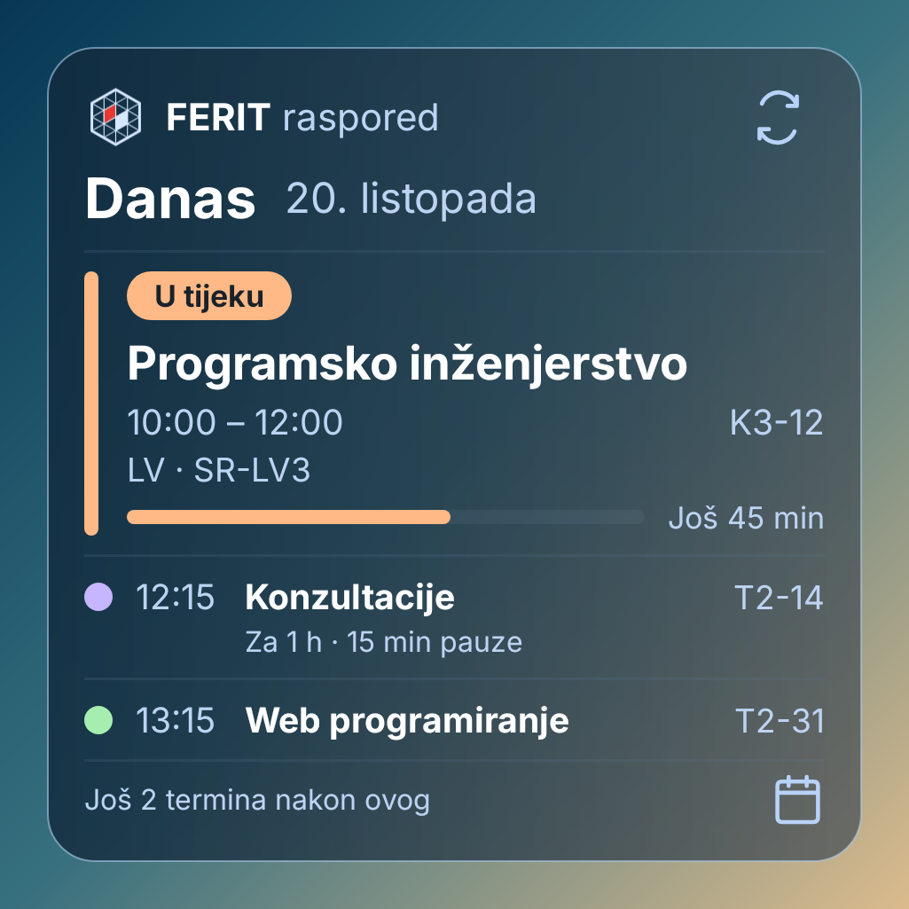

# FERIT raspored — vodič za korištenje

[Preuzmi Android aplikaciju](https://github.com/KTihana/FERIT-raspored/releases/download/v1.0.18-android-test/FERIT-raspored.apk)

Trenutačna verzija: **1.0.18**. [Pregled aplikacije i snimke zaslona](../README.md).

## Dodaj widget na početni zaslon

Nakon instalacije verzije **1.0.18**, u aplikaciji otvori **Postavke → Widget na početnom zaslonu** i potvrdi dodavanje. Ako mobitel ne nudi taj dijalog, zadrži prst na praznom dijelu početnog zaslona, otvori **Widgeti** i odaberi **FERIT · Danas**. Widget možeš rastegnuti; manji prikaz daje prednost trenutačnom i sljedećem terminu.

Widget koristi tvoj studij, LV grupe, ponavljačke predmete i vrste nastave, osobne događaje te spremljene pomake i uklanjanja. Prije nastave prikazuje sljedeći termin; tijekom nastave prikazuje **U tijeku**, traku napretka i preostalo vrijeme. Ispod se vide sljedeći termini, njihova vremena i lokacije te pauza do idućeg termina. Nakon zadnjeg termina pokazuje da je nastava za danas gotova.

Traka računa napredak iz stvarnog vremena mobitela i početka i kraja termina. **Osvježava se svake minute dok je zaslon uključen. Dok je zaslon isključen nema osvježavanja trake; pri uključivanju se vrijeme ponovno izračuna.** Nije potrebno ručno osvježavati da bi vrijeme napredovalo.

Pozadinska provjera rasporeda zakazana je **približno svakih sat vremena**. Android je može odgoditi u dubokom mirovanju ili bez interneta. Dodir **ikone za osvježavanje** u gornjem desnom kutu traži provjeru odmah, a donji redak prikazuje njezin status. Ako preuzimanje ne uspije, ostaje posljednji spremljeni raspored. Dodir kartice ili ikone kalendara otvara aplikaciju na današnjem datumu.

Widget je dostupan na Androidu. Snimka je iz stvarnog izvornog Android prikaza s oglednim terminima.

## Odaberi svoj raspored

Odaberi studij i godinu. Aplikacija pamti odabir i pri sljedećem otvaranju prikazuje raspored za današnji datum.

## Jučer i sutra jednim potezom

Povuci prst **ulijevo za sljedeći dan**, a **udesno za prethodni**. Možeš i **dodirnuti desni rub za sljedeći dan ili lijevi rub za prethodni**, čak i preko obojenog termina. Dugim pritiskom i dalje otvaraš uređivanje. Za određeni datum dodirni datum na vrhu. Položaj i duljina obojenih termina pokazuju trajanje nastave i slobodno vrijeme između termina.

Dodirni datum za kalendar. Povuci **ulijevo za sljedeći mjesec** ili **udesno za prethodni**, odaberi datum pa dodirni **Prikaži**.

## Nastavni tjedan i spremljeni raspored

Oznaka **nastavnog tjedna** nalazi se desno u postojećem donjem retku, u dnevnom i vodoravnom prikazu. Preuzima se iz FERIT rasporeda za prikazani tjedan.

Svaki uspješno preuzet tjedan ostaje spremljen na mobitelu. Ako FERIT nije dostupan ili nemaš internet, prikazuje se spremljeni raspored s oznakom **Spremljeno** i vremenom posljednjeg preuzimanja. Osobni događaji, izmjene i LV odabiri ostaju vidljivi. Pri otvaranju aplikacije, ako današnji tjedan nije spremljen, aplikacija otvara posljednji spremljeni tjedan za isti studij s njegovim stvarnim datumima. Za druge nepreuzete tjedne nudi povratak na spremljeni tjedan. Raspored za tjedan koji još nije preuzet treba internet.

## Svijetla i tamna tema

U **Postavke → Izgled** odaberi **Svijetla** ili **Tamna**. Aplikacija pamti odabranu temu.

## Prikaži svoju LV grupu

U **Postavke → LV grupe** odaberi svoju grupu zasebno za svaki predmet. Možeš biti, primjerice, **LV3 iz Programskog inženjerstva**, a **LV2 iz Web programiranja**. Raspored zatim prikazuje samo odabrane laboratorijske grupe za te predmete; zajednička predavanja ostaju vidljiva.

## Ponavljački predmeti

U **Postavke → Ponavljački predmeti** odmah se prikazuje popis predmeta. Označi predmet, zatim vrste nastave koje želiš vidjeti i dodirni **Spremi odabir**. Dostupna je samo godina neposredno ispod tvoje, unutar istog studija: uz 3. godinu možeš dodati predmete s 2. godine, a uz 2. godinu predmete s 1. godine. Za 1. godinu nema ranije godine za odabir.

Svaki predmet nudi samo vrste pronađene u svojim objavljenim ili spremljenim terminima, pod nazivima koje koristi FERIT, primjerice **PR - predavanja**, **LV - laboratorijske vježbe**, AV ili KV kada postoje. Možeš ostaviti samo predavanja, samo vježbe ili željenu kombinaciju. Odznačavanje zadnje vrste uklanja odabir predmeta. Ako odabereš LV, svoju grupu postavi u **Postavke → LV grupe**.

Odabir vrijedi za dnevni i tjedni raspored te **Ispiti i provjere**. Pamti se zasebno za svaki glavni raspored, a već preuzeti termini i vrste nastave dostupni su i bez interneta. Ako dio rasporeda nije dostupan, prikazuje se obavijest. Vrste nastave koje još nisu provjerene ne dodaju se napamet. Pri otvaranju i osvježavanju rasporeda više se ne pojavljuju kratke trake o učitavanju ili spremljenim ponavljačkim predmetima. Dodir kućice za odabir ne ostavlja dodatni okvir.

 

**Verzija 1.0.18:** otvori **Postavke → Provjeri ažuriranja** za preuzimanje kroz aplikaciju. Instaliraj APK preko postojeće aplikacije da zadržiš svoje odabire. Ručna provjera odmah traži najnovije izdanje.

## Ispiti i provjere na jednom mjestu

Otvori **Postavke → Ispiti i provjere** za nadolazeće ispite i druge provjere iz svojeg odabranog rasporeda. **Najskoriji termin je prvi.** Svaka kartica odmah prikazuje sve dostupne podatke: dan i datum, za koliko je dana, vrijeme, lokaciju, nastavnika, vrstu i grupu, šifru predmeta, redni broj termina i napomenu. Gumb **Prikaži u rasporedu** nalazi se na dnu svake kartice i otvara isti termin u rasporedu.

Filtri koriste stvarne oznake iz FERIT rasporeda, primjerice **kontrolna zadaća**, **Kolokvij** ili **teorijski kolokvij**, kada su objavljene. Oznake su vidljive i na terminima u dnevnom i tjednom rasporedu, čak i kada je vrsta nastave AV, PR ili LV.

Popis pri otvaranju i osvježavanju provjerava trenutačni i sljedećih 15 tjedana. Ako FERIT još priprema raspored za neki tjedan, vidiš njegove datume i obavijest da je raspored još u izradi na FERIT stranici. Problemi s dohvatom imaju zasebno upozorenje da popis može biti nepotpun. Bez interneta mogu se prikazati prethodno spremljeni tjedni.

## Dodaj vlastiti događaj

Dodirni **+** i unesi naziv, datum, početak, kraj i lokaciju. Polje **Datum** otvara isti kalendar kao datum iznad rasporeda: odaberi dan pa dodirni **Odaberi**. Zatvaranje kalendara odbacuje nepotvrđen izbor. Za vrijeme dodirni **Početak** ili **Kraj**. U odabiru pomakni sate ili minute, ili dodirni **Upiši vrijeme** za brojčanu tipkovnicu. **Primijeni** potvrđuje vrijeme; zatvaranje odabira odbacuje promjenu. Odaberi boju i dodaj napomenu — primjerice, što trebaš ponijeti na konzultacije.

Ispod **Napomena** možeš uključiti **Dodaj u Ispiti i provjere**. Takav osobni događaj prikazuje se u filtrima **Sve** i **Ostalo**, a ostaje i u tvojem rasporedu. Isključi opciju pri uređivanju ako ga želiš ukloniti samo s popisa provjera.

Napomena se prikazuje ispod naslova u dnevnom rasporedu. Dodir u dnevnom prikazu ne otvara dodatni panel; za uređivanje zadrži prst na događaju.

## Prilagodi termin kad profesor promijeni vrijeme

**Zadrži prst na terminu** da otvoriš uređivanje. Možeš promijeniti datum, vrijeme ili lokaciju i zapisati napomenu. Na primjeru je termin pomaknut s **08:00–11:00 na 09:00–12:00**, uz prikaz izvornog FERIT termina.

Spremljeni termin dobiva oznaku **Osobna izmjena**. Izmjena se sprema na tvom mobitelu; ne mijenja raspored na FERIT stranici.

## Cijeli tjedan u vodoravnom prikazu

Uz uključenu automatsku rotaciju, **okreni mobitel** za pregled cijelog tjedna. Možeš odabrati i **Tjedan**. Svih sedam dana i vremenska os stanu u jedan pregled, a razmaci između termina ostaju vidljivi.

**Dodirni bilo koji termin u tjednom prikazu** za puni naziv, vrijeme, podebljanu lokaciju, LV grupu, nastavnika i ostale podatke. Detalji se otvaraju preko rasporeda. Dugim pritiskom i dalje otvaraš uređivanje.

## Brisanje uz potvrdu

U uređivanju dodirni **Izbriši događaj** ili **Ukloni iz mog rasporeda**. Aplikacija prvo pita želiš li to učiniti. **Odustani** zadržava termin; **Izbriši** ili **Ukloni** potvrđuje uklanjanje.
